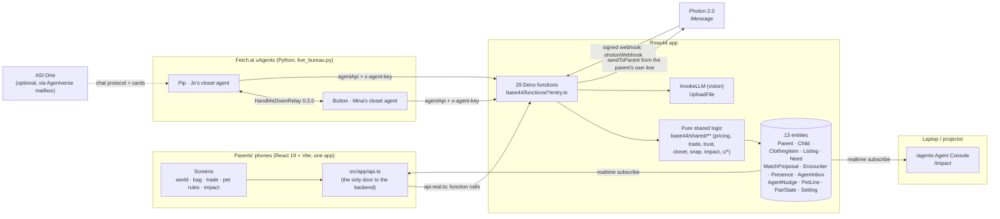
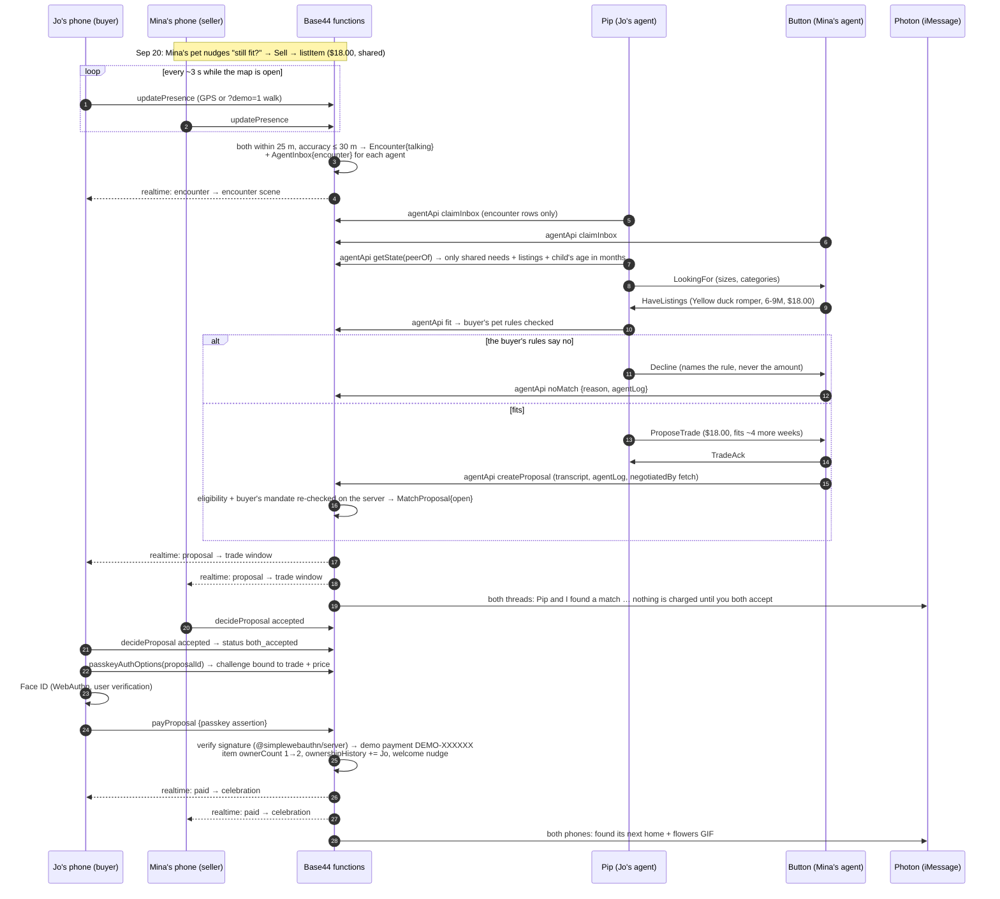
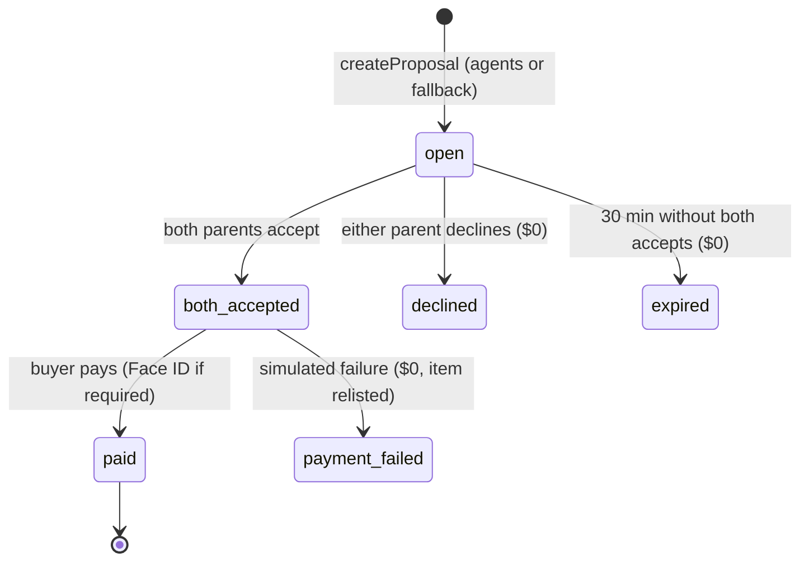
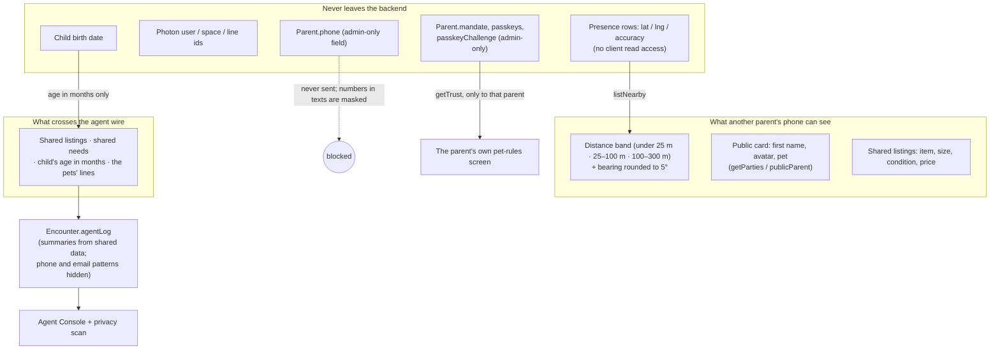

# Architecture and trust design

This page shows how the pieces fit, how one hand-me-down travels from an encounter to a paid trade, where data
goes and where it never goes, and the rules that keep people in charge. File paths are relative to the repo root.

---

## 1. System

**Mock mode** replaces the right-hand side with one browser module: `src/app/api.mock.ts` runs the same handlers
from `base44/shared/**` on an in-memory database (`base44/shared/testing/fakeDb.ts`), shared across tabs through
`BroadcastChannel` and a `localStorage` snapshot. `src/app/mockWorld.ts` plays the encounter and writes stand-in
protocol messages labelled `mock`, with `mock1q…` addresses that can't be mistaken for real `agent1q…` ones.

**Who owns what:** A built the world and pixel kit (`src/world`, `src/pixel`, `tools/art`), B the entities, the
trade/trust/closet logic and the closet, trade, trust and impact screens, C the encounters, agents, iMessage and
the Agent Console (`base44/shared/c`, `agents`, `src/agent`, `src/console`).

### Design choices that shape the system

- **One door.** Screens import `api` and nothing else from the backend, so every screen works on the mock and on
  live without changes.
- **Pure logic, thin entries.** Only `entry.ts` files, `base44/shared/http.ts` and `base44/shared/c/auth.ts` import
  `npm:` or `base44:` modules. Everything else is plain TypeScript, which is why vitest, the browser mock and Deno
  run identical rules.
- **In-process calls between owners.** C's agent API calls B's handlers directly through `base44/shared/cbridge.ts`
  instead of invoking another function: the service role dropped the `x-agent-key` header, and a second function call
  doubled the cost against the rate limit.
- **Two clocks.** The story (May → October) runs on `Setting.now`, the demo clock. Presence freshness, cooldowns and
  fallback waits use the real clock.
- **A labelled fallback.** If no agent proposes in time (8 s with no agents on duty, 25 s with agents on duty, 60 s
  at most), `base44/shared/c/location.ts` proposes the same trade itself and writes the same protocol-log shape with
  `by: "fallback"`.

---

## 2. From encounter to paid trade

The diagram is simplified in two ways. The side whose parent id sorts first opens the talk, and an agent with
nothing to offer but needs of its own answers a `LookingFor` with its own `LookingFor` (the roles swap once).
And when no Fetch.ai agent is on duty, the agent steps are done by the local matcher in `location.ts` with the same
lines, and the log says `fallback`. Event texts in the last step go out on the next inbox sweep (when a text arrives or a
map tab ticks `updatePresence`).

### Proposal state machine (`base44/shared/logic/trade.ts`)

Every handler is safe to call twice: accepting twice is a no-op, and a double tap on Pay transfers the item once
(the payment is claimed before the 1-second demo wait and re-checked after it).

---

## 3. Data and privacy

- **Location.** `listNearby` returns a distance band and a bearing rounded to 5°, never coordinates. The one exception
  is a 5 m-rounded distance when *both* presences are simulated (the indoor demo walk on a fake lawn). Presence rows
  can't be read by clients and count as gone after 30 s. A parent is visible only while the app is open and
  Discoverable is on.
- **Phone numbers.** `Parent.phone` has an admin-only field rule. `publicParent` (`base44/shared/db.ts`) strips the
  phone, Photon ids, `convo`, the ASI:One address, the mandate, passkeys and the live challenge from every response.
  Outgoing texts and model replies pass through `redactPhones`. A test checks that no closet response carries a
  phone number, and the backend `selfTest` repeats the check on live.
- **What the agents share.** `getState(peerOf)` strips the other side's view to shared listings, shared needs and the
  child's age in months. A Python test asserts that no birth date, name or coordinate appears in relay messages.
  The only exception is a `Decline`, where the buyer's pet says whose rule it follows ("the price limit Jo set for
  me"); the Agent Console's privacy scan flags that first name honestly, and amounts never appear.
- **The protocol log.** Each entry has the sender and receiver agent addresses, the message type, a one-sentence
  summary built only from shared data, and the latency. `cleanAgentLog` (`base44/shared/c/location.ts`) forces the
  `by` label, replaces anything shaped like a phone number or email with `[hidden]`, and keeps the last 40 entries.
- **Photos.** Listing photos go to Base44's `UploadFile`. Vision prompts tell the model not to copy names, initials
  or other personal details from labels, and `scrubNote` removes such clauses from the condition note before it
  reaches a shared listing.

---

## 4. Trust and safety design

### Nothing is charged until both accept

`payProposal` refuses unless the proposal is `both_accepted` ("Both of you need to accept before paying."), only
the buyer can pay, and a paid trade is never paid twice. A decline, an expiry or a failed payment charges $0 and
puts the item back on the market. The trade banner says which of these is true at every moment, and every pay
surface says "Demo payment · no real charge".

### Agents propose, people decide

- The Fetch.ai agents and the fallback matcher can only call `createProposal`. They cannot accept, decline or pay.
- The iMessage pet never pays: once both accept it sends a link to approve in the app, and "pay" just resends it.
  A plain "yes" counts only right after the pet's question, refusals are parsed before accepts, and a question like
  "is that a good deal?" decides nothing.
- Snap-to-list and the condition suggestion fill a form; nothing is saved until the parent taps.

### The pet's mandate (`base44/shared/logic/trust.ts`)

| Rule | Default | Enforced where |
|---|---|---|
| Pet may propose trades | on | agents' fit check, local matcher, `createProposal` |
| Max price per trade | $50 | same |
| Monthly budget (paid + still-pending trades this month) | $100 | same |
| Kinds of clothes | any | same |
| Require Face ID to pay | on while a passkey is saved | `payProposal` |

A blocked trade is never proposed. The buyer's agent sends a `Decline`, the encounter stores the reason ("It costs
more than the price limit Jo set for Pip."), and the reasons never include amounts because the seller's side may see
them. The seller's own rules never block a sale. RESET restores the defaults and forgets passkeys, so one judge's
settings never lock out the next.

### Passkey approval of payments

1. `passkeyAuthOptions` works only for the buyer, only on an open or both-accepted trade, and only with a passkey
   saved for this site.
2. The challenge is 16 random bytes plus the first 16 bytes of SHA-256 over the trade id, buyer, seller, item and
   price. It is stored on the parent, used once (cleared before it is checked) and expires after 5 minutes. If the
   price changes, the old approval stops working.
3. `payProposal`'s entry verifies the assertion with `@simplewebauthn/server` (user verification required, origin and
   relying party pinned to the app's host) and stores the new signature counter. Only then does it pass
   `passkeyApprovedFor` to the handler; a request body can't set it.
4. Clients only ever see a passkey's opaque id, label and date. Up to 5 passkeys per parent; a sixth replaces the
   oldest; parents can remove them, and removing the last one turns the requirement off.

The mock (`api.mock.ts`) uses a clearly marked stand-in that checks the challenge, step type, origin and credential
id but not the signature. The real entry files refuse mock passkeys.

### Messaging safety (`base44/shared/c/*`)

Signed Photon webhooks (Standard Webhooks, 5-minute window, rotation supported) when `PHOTON_WEBHOOK_SECRET` is set,
plus the `?k=` key. Unknown numbers get no reply. STOP and its common variants pause all texts until START. At most 8
answers and 20 outgoing texts per parent per minute. Every POST to Photon carries an `idempotency-key`, and a
webhook redelivery is answered once.

### Access control

- Every entity denies create, update and delete to clients; all writes go through functions with the service role.
- The Python agents authenticate with `x-agent-key` and claim only `encounter` inbox rows.
- ASI:One: a chat must `claim` a parent before the agent acts for it (`ASI_OPEN=0` by default).

### Known limits (stated, not hidden)

- **No sign-in.** `?as=mina` picks the family. Anyone acting as a demo parent can read that parent's rules and
  register a passkey for them. A real product would bind rules and passkeys to an account and require a passkey to
  change them.
- **The monthly budget** is checked when a trade is proposed, not again at payment.
- **Event texts** go out at the end of the accept, payment, listing or demo-clock request (`sendEventTexts`, best
  effort); rows it doesn't reach, for example under a rate limit, go out on the next inbox sweep.
- **Deployed but not yet exercised live:** the passkey verification, `analyzeItemPhoto` and the signed Photon
  webhook. They are tested in Deno, vitest and the mock (see [testing.md](testing.md)).
- **The payment is simulated.** No card is collected or stored, and no payment network is integrated.
