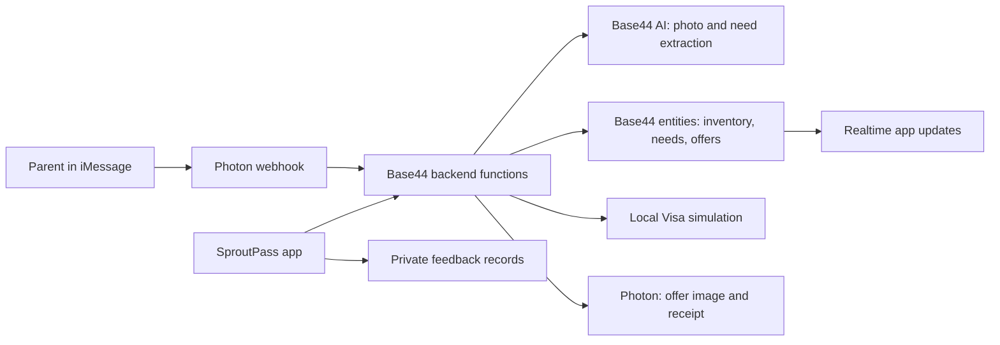

# SproutPass architecture

The React app and Photon webhook use the same Base44 entities and trade handlers.

## Approval and transfer

A shared listing authorizes the seller’s side. `approveDemoTrade` records that authorization and the buyer’s explicit decision. Accepted offers pass through `payProposal`; saved passkey requirements remain enforced. The default demo completes without an additional Pay button. Declining does not create a payment and leaves the garment with its seller.

`MatchProposal.visaSimulation` records a synthetic token, USD amount, authorization reference, capture status and timestamps. These are local simulation records. Ownership updates and the sold listing are real Base44 writes; money does not move. Completed approvals return the existing receipt on retry.

## Demonstration evidence

`prepareTrial` adds a sample marked `trialSample`, a matching need and, on explicit request, a proposal. It does not fabricate a photo-message ID, erase existing inventory, approve for the buyer, or invent feedback. `trialStatus` reads actual records and reports progress. `PetLine.deliveryStatus` records whether Photon accepted a text submission; `imageSubmitted` tracks the attachment independently. These are not delivery/read receipts.

## Feedback

`submitFeedback` validates answers and writes `UserFeedback`. Entity reads/writes are private; the public function only accepts a response and returns its identifier. The participant identifies whether they are a parent/caregiver, teammate, or other tester. Anonymous quotation is opt-in. The team reviews records with privileged access.

## Current boundaries

The demo uses known family identities selected in the UI. Production user authentication and per-family authorization still need hardening. Private iMessage mappings are separated from group reply destinations. Group handling exists in code, but real group messaging requires a dedicated Photon line and has not been verified. The local matcher produces listed-price offers; legacy optional agent experiments are not required for the main demo.
